# Adam Hubbs

**Data analytics · Political science · Business strategy**

Analyst at Y2 Analytics, Salt Lake City, UT. I build R tools for survey research and reporting, and editor tooling that brings R into the places analysts already work.

<!-- stats:start -->

-1438-F08A4B?style=flat-square)
<!-- stats:end -->

---

## Focus

- **R packages** for analysts: presentation automation, large-scale LLM workflows, and fast survey algorithms.
- **Developer tooling** for [Positron](https://positron.posit.co/) and VS Code, including hover docs and label inspection for R scripts.
- **Survey and market research methods**, with a focus on tabulation, conjoint design, and TURF analysis.

## Key projects

| Project | What it does | Language | Stars |
|---|---|---|---|
| [**r2slides**](https://github.com/Adam-Hubbs/r2slides) | Create and update Google Slides and Sheets straight from R. Push tables, charts, and images into a deck. | R |  |
| [**DBAI**](https://github.com/Adam-Hubbs/DBAI) | Call OpenAI, Anthropic, and Google models on R datasets with one consistent interface, for sentiment, imputation, synthetic data, and more. | R |  |
| [**y2turf**](https://github.com/Adam-Hubbs/y2turf) | Fast TURF (total unduplicated reach and frequency) analysis. The search runs in Rust via savvy. | R, Rust |  |
| [**rozone**](https://github.com/Adam-Hubbs/rozone) | Roxygen hover and signature help for plain R scripts in Positron and VS Code. | TypeScript, Rust |  |
| [**haveninfo**](https://github.com/Adam-Hubbs/haveninfo) | Positron extension that shows haven variable and value labels as tooltips on hover. | TypeScript |  |

## Languages

<picture>
  <source media="(prefers-color-scheme: dark)" srcset="assets/languages-dark.svg">
  
</picture>
